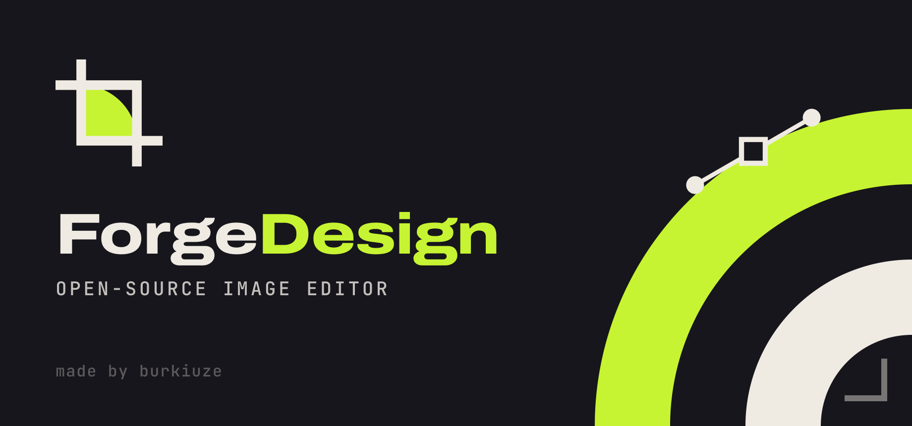

<p align="center">
  
</p>

# Forge Design

**Forge Design**, Rust ile yazılmış, açık kaynaklı ve yüksek performanslı bir
raster görüntü düzenleyicisidir. Hedef: Adobe Photoshop'un iş akışını ve
özelliklerini ücretsiz, hızlı ve platformlar arası bir uygulamada sunmak.

> *An open-source, high-performance Photoshop alternative written in Rust.*

## Neden hızlı?

| Teknik | Etkisi |
| --- | --- |
| **64×64 döşemeli (tiled), seyrek, copy-on-write piksel deposu** | Boş alanlar bellek harcamaz. Katman kopyalamak sadece işaretçi kopyalar. Geri alma (undo) adımları yalnızca değişen döşemeleri saklar. |
| **Rayon ile paralel işleme** | Kompozit, filtreler, ayarlamalar ve yeniden boyutlandırma tüm CPU çekirdeklerini kullanır. |
| **Kirli bölge (dirty-rect) takibi** | Yalnızca değişen bölgeler yeniden kompozit edilir ve GPU'ya yüklenir. |
| **Parçalı GPU dokuları (1024 px)** | Her boyutta belge açılabilir; düzenlemeler sadece etkilenen parçaları günceller. |
| **LUT tabanlı ayarlamalar, O(1) bulanıklaştırma** | Levels/Curves/Invert piksel başına tek tablo okuması; büyük yarıçaplı Gaussian 3 geçişli kutu bulanıklığı ile yarıçaptan bağımsız. |

Örnek: 4000×3000 (12 MP) görüntüde 20 px Gaussian blur + unsharp mask, PNG
okuma/yazma dahil 4 çekirdekte ~2 sn.

## Özellikler (v0.1)

- **Belgeler:** yeni belge (hazır boyutlar), çoklu sekme, sürükle-bırak, kaydedilmemiş değişiklik uyarısı
- **Dosya formatları:** OpenRaster `.ora` (yerel, katmanlı — GIMP/Krita uyumlu), **PSD içe aktarma (katmanlarla)**, PNG, JPEG, WebP, TIFF, BMP, GIF, TGA, ICO, QOI, PNM, HDR/EXR okuma; dışa aktarma
- **Katmanlar:** oluştur/çoğalt/sil, sürükle-bırak sıralama, yeniden adlandırma, görünürlük, opaklık, kilitler (şeffaflık/tümü), birleştir, görüneni damgala, düzleştir, **katman maskeleri** (fırçayla düzenleme, uygula/sil/devre dışı bırak)
- **27 karıştırma modu:** Photoshop'taki tüm modlar (Normal, Dissolve, Multiply, Screen, Overlay, Soft/Hard/Vivid/Linear/Pin Light, Hard Mix, Difference, Exclusion, Subtract, Divide, Hue, Saturation, Color, Luminosity, Darker/Lighter Color…)
- **Araçlar:** Move, Dikdörtgen/Elips Seçim, Lasso, Sihirli Değnek, Kırpma, Damlalık, Fırça, Kalem, Damga (Clone Stamp), Silgi, Degrade (5 tip), Boya Kovası, Metin, Şekil (dikdörtgen/elips/çizgi), El, Yakınlaştırma
- **Seçimler:** yeni/ekle/çıkar/kesişim, yumuşatma (feather), genişlet/daralt/kenarlık, tersine çevir, katman şeffaflığından seçim, yürüyen karıncalar
- **Ayarlamalar:** Brightness/Contrast, Levels, Curves (etkileşimli editör), Exposure, Vibrance, Hue/Saturation (+Colorize), Color Balance, Black & White, Photo Filter, Gradient Map, Invert, Posterize, Threshold, Desaturate, Auto Contrast — hepsi canlı önizlemeli
- **Filtreler:** Gaussian/Box/Motion Blur, Sharpen, Unsharp Mask, High Pass, Add Noise, Median, Twirl, Wave, Mosaic, Emboss, Find Edges, Clouds; Son Filtreyi Tekrarla (Ctrl+F)
- **Görüntü:** Image Size (Nearest/Bilinear/Bicubic/Lanczos-3), Canvas Size (çapa), döndür/çevir, seçime kırp, şeffaflığı kırp, Serbest Dönüştürme (ölçek/döndürme/öteleme/ayna)
- **Düzen:** geri al/yinele (100 adım, History paneli), kes/kopyala/birleşik kopyala/yapıştır, Fill, Stroke
- **Arayüz:** Photoshop benzeri yerleşim, araç seçenek çubuğu, Renk/Histogram/Geçmiş/Katmanlar panelleri, Photoshop klavye kısayolları
- **forge-cli:** komut satırından toplu işlem (`forge-cli in.psd --resize 1920x0 --sharpen -o out.jpg`)

Tam özellik listesi ve durumu için bkz. [ROADMAP.md](ROADMAP.md).

## Derleme

Rust (stable) gerekir: <https://rustup.rs>

```sh
cargo run --release -p forge-app          # masaüstü uygulaması
cargo run --release -p forge-cli -- --help # komut satırı aracı
cargo test --workspace                     # testler
```

Linux'ta ek paketler: `libxkbcommon-x11-0`, OpenGL sürücüsü (Mesa).

## Proje yapısı

```
crates/
  forge-core/   Motor: döşemeli tamponlar, katmanlar, karışım modları, fırça,
                seçimler, filtreler, ayarlamalar, dönüşümler, geçmiş (GUI'den bağımsız)
  forge-io/     Dosya formatları: OpenRaster, PSD, raster içe/dışa aktarma
  forge-app/    egui/eframe tabanlı masaüstü uygulaması (`forge`)
  forge-cli/    Başsız toplu işlem aracı (`forge-cli`)
```

## Lisans

Apache License 2.0 — bkz. [LICENSE](LICENSE).

Made by **burkiuze**.
